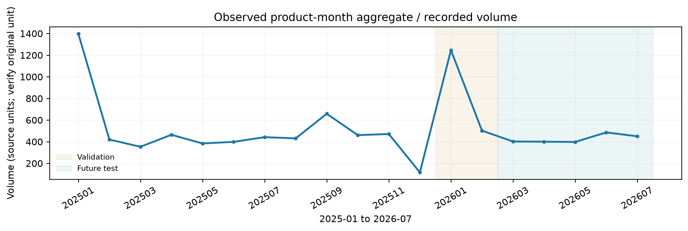
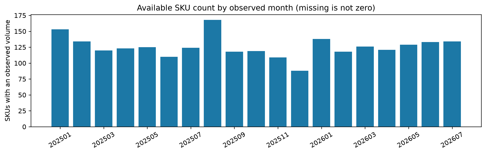
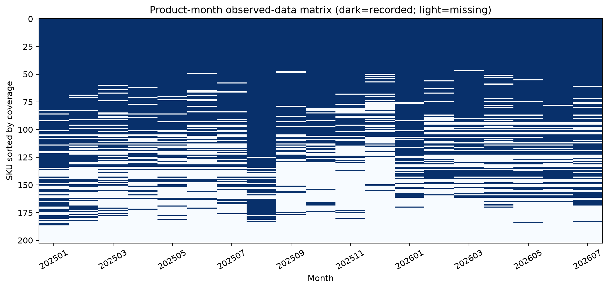
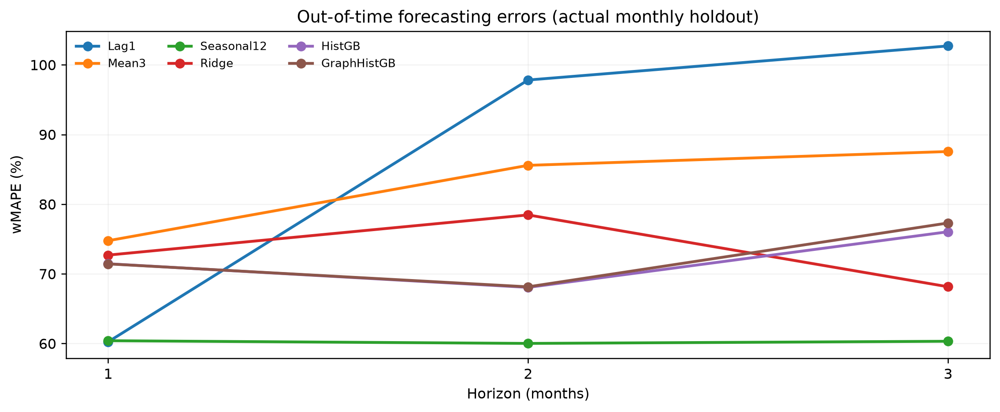
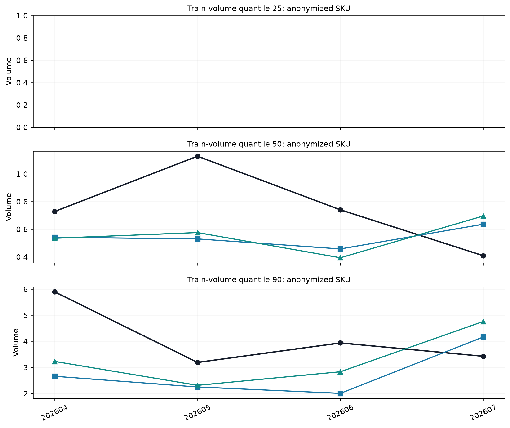
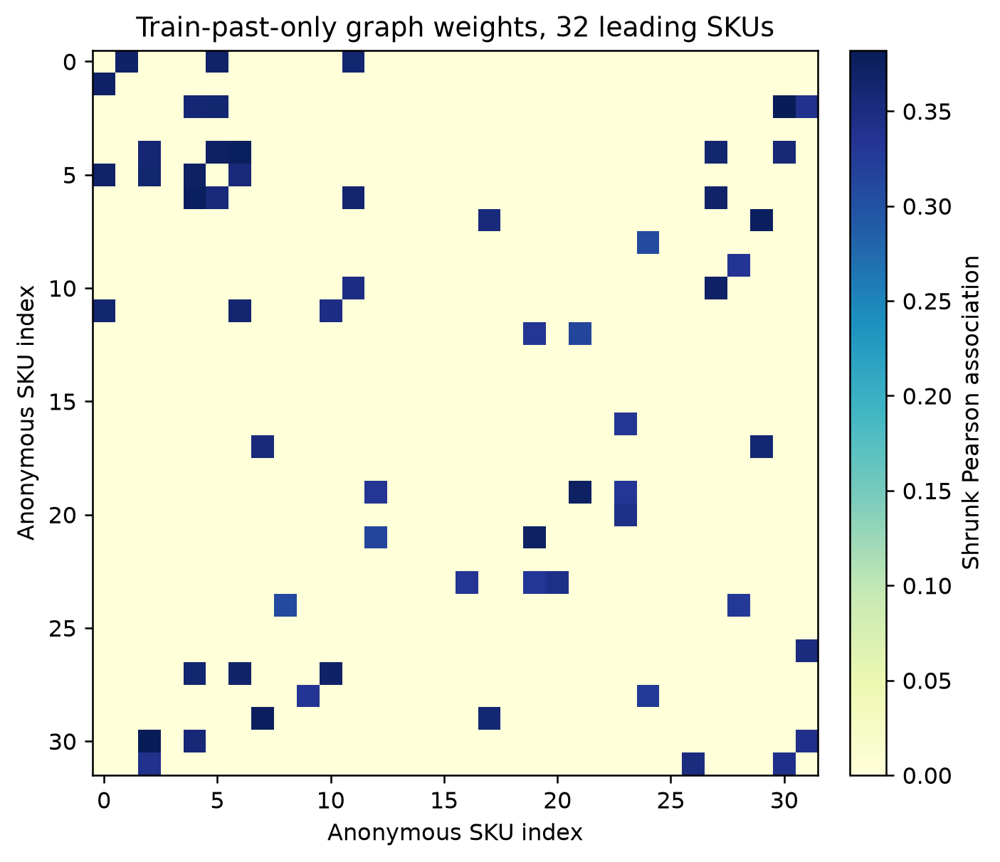
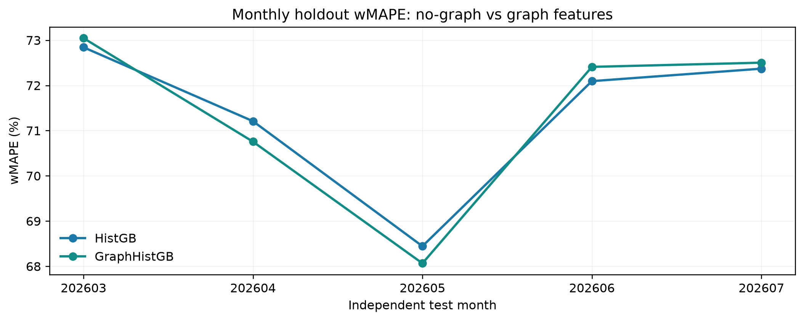

# 卷烟多品规销量预测中的关联信息增益研究

Predictive value of inter-specification associations in cigarette sales forecasting

> V1 · 真实数据先导实证稿 · 非投稿定稿 | 2026-11-18 | 作者及单位待填写

## 摘要

【目的】检验卷烟品规间历史变化的统计关联能否提供独立于单品规历史销量的预测信息，为选择时序预测与图关联建模技术提供实证依据。【方法】依据某市2025年1月至2026年7月的品规经营报表，重核原始销售汇总与历史面板，以203个品规、3149条品规—月份记录构建观察数据，采用严格按月划分的训练、验证和未来测试集。以简单滞后预测、移动均值、岭回归及梯度提升树为基线，引入仅使用预测时点之前6个月变化计算的收缩相关图特征，比较1～3个月预测结果，并通过测试月份块式重采样分析增益稳定性。【结果】实际可用销量记录2390条，原表与面板成功匹配的2390条记录数值一致。未来1个月测试共478条记录；上月销量直接预测的加权绝对百分比误差（wMAPE）为60.24%，梯度提升树为71.45%，加入图特征后为71.43%，相对于未加图特征模型仅降低0.021个百分点。其差异的探索性95%区间为（-0.261，0.307）个百分点，置信区间跨越0，未显示稳定增益。【结论】现有19个月的月度数据尚未证明图关联特征具有稳健预测收益，也不支持将该结果解释为消费者品规替代。开展正式图神经网络研究前，应首先改善数据时间粒度、覆盖程度与供给状态记录。

**关键词**：卷烟营销；多品规预测；图关系学习；时间外推；实证验证

## Abstract

[Objective] This study evaluates whether historical associations across cigarette specifications provide additional out-of-time predictive information beyond product-specific sales histories. [Methods] A one-city product-month panel from January 2025 to July 2026 was reconstructed and cross-checked against original XLS reports. The panel contained 203 specifications and 3149 product-month records. A temporally constrained, shrunk correlation graph was used to augment gradient-boosted forecasts and compared against persistence, moving averages, ridge regression and the same boosted model without graph features. [Results] Of 3149 panel records, 2390 had an observed non-missing volume. In the one-month holdout (478 matched observations), persistence yielded a weighted absolute percentage error of 60.24%, compared with 71.45% for the ordinary gradient-boosted baseline and 71.43% for its graph-augmented variant. The difference was too small to establish a reliable benefit under a five-month block bootstrap. [Conclusion] The current short, incomplete monthly history is insufficient to establish a reproducible gain from inter-specification graph features or any causal interpretation of product substitution. Longer and better documented records are needed before claiming advantages for graph neural networks.

**Keywords**: cigarette marketing; product forecasting; graph association; temporal holdout; reproducibility

## 0 引言

卷烟货源组织和市场运行监测具有显著的品规异质性。单一品规的月度销量既反映其既有经营规模，也受到节令、货源投放安排、价格与渠道承接等因素的共同影响。围绕销量的准确预测，不仅需要拟合序列随时间的变化，还需要判断跨品规信息是否能够为新的预测时点提供额外信号。尤其在品规间相互关联程度未知、品规上市和退出并存的情形下，直接把全部品规视为相互独立的预测对象，可能遗漏共同波动；但仅凭品规销量同步变化就推断消费替代关系，又缺乏足够的识别依据。

针对卷烟市场复杂时间序列，蒋兴恒[1]采用集合经验模态分解、自适应参数优化与分项建模的集成方法研究品牌销量预测；崔建华等[2]提出以多层感知机为主、大语言模型辅助解释业务规则的预测控制体系，强调卷烟销量的周期性、节令性和策略性。上述成果分别从时间尺度分解和规则约束预测角度推进了研究。另一类研究通过零售客户分档、市场状态评价和数据驱动投放策略，将经营数据用于管理判断[3-5]。这些研究表明，卷烟商业数据中的业务口径和约束条件不能被一般消费品数据建模假设替代。

图神经网络提供了跨序列关联学习工具。Graph WaveNet[6]通过自适应邻接学习发现未知关系，MTGNN[7]进一步结合图学习、图传播与扩张时间卷积开展多变量预测；图注意力网络（Graph Attention Network，GAT）[8]则通过注意力权重处理节点间信息传递。与此同时，时间融合Transformer（Temporal Fusion Transformer，TFT）[9]强调静态变量、历史观测和未来已知变量的有区别建模。然而，这些具有代表性的深度模型通常在时间覆盖较充分的序列上得到评估。对不足两年的品规月度面板，先判断关联信号能否超越简单预测，再选择复杂模型，比直接叠加注意力与图卷积更符合严格实验要求。

本文以可核验的历史品规月度面板为对象，把研究问题收敛为：基于预测时点以前的多品规历史，能否通过关联信息提高下期已实现销量的样本外预测精度？围绕该问题，建立原始报表与历史面板的交叉核对程序，构造严格遵守信息时点的收缩关联图，并将图特征添加到相同基学习器中，通过强业务基线、未来月留出和消融比较检验关联增益。本文的定位是正式图神经网络论文之前的数据与机制先导实验，目的不是预设复杂方法一定优于简单方法，而是明确哪些技术贡献已被证实、哪些仍需进一步验证。

## 1 数据与研究问题

### 1.1 数据来源与研究对象

研究数据来自某市卷烟经营管理报表，时间范围为2025年1月至2026年7月。原始资料按月份保存于“多指标销售汇总”“多规格按日查询”和“品牌月进货情况查询”3类工作簿，共57份旧版Excel文件。其中“多规格按日查询”是业务报表名称，原始表按品规列示本期经营指标，既有历史数据构建代码也将其聚合到品规—月份主键，因此本研究不将其误认成连续逐日交易明细。继承历史版本中的raw_panel_v1.csv，对品规编码、年月、销量字段进行独立核查。

面板共3149条品规—月份记录，覆盖203个品规、19个日历月；其中销量字段非缺失记录2390条（75.9%），缺失759条，显式记录的零销量460条。研究在准备数据时区分缺失和明确记录的0值，不对缺失样本随意填充。对原始“多指标销售汇总”工作簿逐月读取品规编码和销量数值，将其与历史面板按“品规编码—月份”逐项核对：成功匹配的2390条记录差额均为0。由于历史构建时曾对品规至少出现6个月作过筛选，不能把上述面板直接等同于该市所有品规的完整总体。

**表1 实验数据来源与可用性**  
*Tab. 1 Sources and limitations of the experimental data*

|数据来源|业务粒度|核验内容|使用范围|
|---|---|---|---|
|多指标销售汇总（19份）|品规×月份|销量与历史面板数值核对|真实预测目标|
|多规格按日查询（19份）|当前资料为品规×月份报表|22列业务指标；并未证实逐日序列|原始口径与辅助审计|
|品牌月进货情况查询（19份）|品规×月份|库存、供给相关业务属性|留待约束条件核实|
|历史raw_panel_v1.csv|品规×月份|203品规、3149记录、58字段|统一特征主表|
注：数据均为实际已有文件。源报表的销量计量单位仍需依据业务系统字段说明最终核准。

**图1** 品规月度销量汇总变化  
*Fig. 1 Monthly aggregate of observed product volume*

注：仅对有实际记录的品规求和；不同月份覆盖SKU数量不同，跨月波动不能直接解释为总体市场变化。

**图2** 不同月份有效品规记录数  
*Fig. 2 SKU coverage across observed months*

注：浅缺失不自动推断为销售量为0。

### 1.2 预测目标和信息时点

用i表示品规、t表示月份、h表示预测提前期，y_(i,t)为原报表记录的第i个品规在t月的已实现销量。在t月初发出预测时，只能使用t月之前已经公开或已完成记录的信息集I_(t−1)，对未来h个月的目标写为ŷ_(i,t+h−1)=f(I_(t−1),h)。若该值受供给限制，预测结果只能解释为已实现业务量，不能未经核验解释为潜在需求。

对于预测任务，首先用本品规历史3个月销量构造滞后值、移动均值和波动指标，已知月份信息仅采用目标月的日历位置。由于历史报表未提供可靠的品规×日连续记录，不采用每天、每周或未来7天等与当前数据不一致的实验标签。年度季节基线另以相同月份上年销量进行对照，并明确其有效样本可能少于其他模型。

### 1.3 数据缺失及样本选择

本研究不把原始面板中的缺失直接置0。只有预测时点之前连续3个月具有真实观测值、目标月份实际销量可得的样本进入相应预测窗口；因而测试集覆盖的品规是相对稳定的经营子集。对比实验使用固定目标月份和相同有效观测，在单独比较季节性12个月滞后基线时标明分母变化。缺失样本和新增品规可能与供给、上市和渠道条件相关，分析结论不外推至完全无历史的新上市品规。

**图3** 品规月份数据有效性分布  
*Fig. 3 Product-month observation matrix*

注：图中深色仅表示该月存在记录，不表示销量大小或消费者购买状态。

## 2 方法

### 2.1 整体技术路线

为识别跨品规关联本身是否增加预测信息，本研究采用“历史面板审计—无图强基线—时点约束图学习—相同预测器消融—未来月份验证”的技术路线。其关键是保持预测器容量和输入时间条件基本一致，仅增加由历史其他品规产生的特征。与直接训练GAT、MTGNN或TFT相比，该先导设计更容易辨认增益来源，也能降低短时间轴下深度网络参数估计不稳定的风险。

### 2.2 仅使用预测前信息构造关联图

对每一个预测原点t，取前6个可观察月份的各品规销量，计算对数变化r_(i,τ)=ln(1+y_(i,τ))−ln(1+y_(i,τ−1))。在同一时间窗内，对品规i和j的共同有效变化求Pearson相关系数ρ_(ij,t)；鉴于最多只有5个相邻月变化样本，相关系数极不稳定，采用非负截断与样本数收缩：a_(ij,t)=max(0,ρ_(ij,t))·n_(ij,t)/(n_(ij,t)+8)。保留满足最少4个重叠变化并超过预设阈值的候选关系，每个节点至多5个邻居；为了避免单向筛选导致稀疏图出现不对称不可靠连接，最终保留互相入选的边。

此处的ρ不是严格意义上的替代弹性或需求交叉效应，只是预测时点之前历史涨跌的统计依赖。共同节令、配额、货源收缩和市场趋势都可能使两个品规的销量相关，无法据此将边权解释为消费者从一个品规迁入另一个品规。任何关于消费迁移的因果结论仍需消费者层级的连续购买数据和恰当识别设计。

### 2.3 跨品规历史特征与基学习器

对图中的有效邻居j，计算预测原点前1期和前2期对数销量之差，并以a_(ij,t)归一加权得到邻域历史变化g_(i,t)。同时记录有效邻居数量d_(i,t)作为关系稀疏度指标。普通模型以历史3期对数销量、均值、波动与月份正余弦为输入；图增强模型在完全相同的基础上增加g_(i,t)和d_(i,t)。二者都使用相同的梯度提升树（Histogram-based Gradient Boosting，HistGB），以免把网络结构复杂度误当成图信息收益。

为保持可复现性，树模型预先规定为85轮迭代、12个叶节点、最少叶样本26、学习率0.06和L2正则化8，固定随机种子42；目标使用ln(1+y)减少大销量品规的偏态影响，并对预测输出逆变换和零下限截断。岭回归采用标准化历史特征和固定正则系数50。本文并未训练原始MTGNN或GAT，因此将方法称为“图关联特征先导模型”，不声称实现了端到端图神经网络。

### 2.4 评价指标

采用平均绝对误差（MAE）及加权绝对百分比误差（wMAPE）评价预测水平。MAE=Σ|y−ŷ|/n，wMAPE=Σ|y−ŷ|/Σ|y|，后者在所有有效测试点汇总后计算，而不直接平均单个品规百分比误差。另报告有符号预测偏差，用于判断复杂模型是否系统低估高销量品规。

为比较关联增益，定义ΔwMAPE=wMAPE_(无图HistGB)−wMAPE_(图特征HistGB)；正值表示图增强模型改善。以2026年3—7月的目标月份为重采样单位进行500次块式Bootstrap，得到探索性95%区间。由于只有5个独立月份块，区间稳定性有限，不把跨品规的数百条记录当成数百个独立时间试验。

## 3 实验设计

### 3.1 时间划分与预测窗口

根据原始面板的观测边界，训练目标限制在2025年12月及以前，2026年1—2月用于验证，2026年3—7月全部留作独立未来测试。历史窗口采用此前3个月构造滞后输入，额外利用截至预测原点的前6个月构造邻接图；模型分别估计h=1、2、3个月提前期。无论预测步长大小，图结构和所有特征均只能使用预测原点之前的有效销量，不允许在构造月度图时使用目标月或更晚月份的全样本数据。

**表2 不同预测步长的实际有效样本**  
*Tab. 2 Effective training and test observations by horizon*

|提前期/月|训练记录数|验证记录数|测试记录数|测试品规数|
|---|---|---|---|---|
|1|546|147|478|120|
|2|438|157|441|120|
|3|331|172|404|110|
注：训练、验证和测试为品规—目标月份记录数；不同提前期的入选样本不完全一致，比较必须在相同提前期内进行。

### 3.2 对照模型与消融设置

为避免只与弱基线比较，设置7组方案：Lag1（以上一期实现量直接预测）、Mean3（历史3个月平均）、Seasonal12（上一年同月实现量）、PeerLag（简单邻居增长率外推）、Ridge（仅本品规历史的岭回归）、HistGB（仅本品规历史的梯度提升树）和GraphHistGB（增加邻域变化与邻居数量的相同梯度提升树）。其中HistGB与GraphHistGB是预先指定的成对消融对照；Seasonal12使用单独可得的有效子样本，不能直接与全样本模型进行无条件排名。

**表3 对照方法与主要检验目的**  
*Tab. 3 Baseline methods and hypotheses*

|对照方法|信息来源|检验目的|
|---|---|---|
|Lag1|本品规上一月销量|市场惯性是否已经足够|
|Mean3、Seasonal12|自身历史均值、上年同月|趋势平滑和年度季节性|
|Ridge、HistGB|本品规历史与目标月位置|线性与非线性建模增益|
|PeerLag|邻居历史变化外推|直接复制关联变化是否有效|
|GraphHistGB|HistGB输入＋预测时点之前图特征|关联信息的边际贡献|
注：每项预测使用同一真实目标销量字段。未训练TFT、MTGNN、GAT，不能将图增强树模型成绩标为这些深度模型的性能。

### 3.3 数据审计与复现约束

源文件均使用只读方式处理，记录原始文件数、工作表行列数、可读取品规编码和数字单元格数。通过sha之外的业务主键严格按“月—品规”匹配原报表与历史面板；发现重复键不进行自动加总。训练样本选择、图相关计算和数据变换在脚本中固定，结果保存为结构化JSON及CSV聚合表；科研图由同一脚本直接生成PNG和SVG，便于复核和期刊排版。

## 4 结果与分析

### 4.1 数据覆盖与来源一致性

原始核验表明，某市19个月面板共有203个品规、3149条记录，实际可用于销量统计的非缺失记录2390条，占75.9%；缺失销量759条，明确为0的有效销量记录460条。在全部2390条成功与原始销售汇总报表关联的有效销量记录中，数值精确一致比例达到100.0%。这说明已有CSV并非仅有论文汇报数字，而具有可重新追溯的源表基础。但不同月份有效品规数存在明显变化，直接比较未对齐品规集合的月度总量会混入样本覆盖变化。

图1和图2分别展示业务实现量的月度汇总及有效记录SKU数量。图3进一步将203个品规的19个月记录状态按覆盖率排序，可观察到部分品规长期断续缺报。样本覆盖不齐不仅影响时间序列平稳性判断，还会改变模型训练时的目标分布。由于原始业务系统中的停供、暂未上市和零购进状态尚无独立可复核标记，本研究暂不对这些缺报给出经营原因分类。

### 4.2 未来1个月预测效果

在2026年3—7月独立测试期，能够同时构成有效历史3个月特征和目标值的共有478条品规—月份记录，涉及120个品规。Lag1的wMAPE为60.24%，MAE为2.500；仅使用本品规历史的HistGB为71.45%、2.965，加入关联图历史特征后的GraphHistGB为71.43%、2.964。就该真实测试集而言，最简单的上月保持基线明显优于两个树模型，说明对短月度面板而言，复杂非线性模型未必能充分利用额外自由度。

在严格配对的478条测试记录上，关联特征使HistGB的wMAPE相对变化仅为降低0.021个百分点；按测试月份分块重采样得到95%差异区间（-0.261，0.307）个百分点，置信区间跨越0，未显示稳定增益。与此相对，PeerLag把其他品规的增长变化直接用于外推，误差进一步放大，说明高相关历史涨跌并不能直接作为本品规下一期的预测增长率。这一负面发现必须与正面结果同等报告。

### 4.3 多步预测对比

当预测提前期扩展到2个月、3个月时，不同方法的误差和可评价样本数发生变化。为避免从图中视觉选择结果，表4逐一给出相同目标定义和固定预测提前期下的真实计算指标。需要特别指出，Seasonal12模型只有存在上年同月有效销量时才能评价，有效点数与其余模型不同，因此其汇总误差仅作参考；表中的最低数值不应跨不同样本分母直接认定模型绝对优胜。

**表4 未来1～3个月预测的wMAPE结果**  
*Tab. 4 Weighted absolute percentage error across horizons*

|模型|提前1个月|提前2个月|提前3个月|
|---|---|---|---|
|Lag1|60.24% (478)|97.82% (441)|102.71% (404)|
|Mean3|74.76% (478)|85.57% (441)|87.56% (404)|
|Seasonal12|60.41% (368)|60.02% (356)|60.33% (341)|
|Ridge|72.69% (478)|78.46% (441)|68.15% (404)|
|HistGB|71.45% (478)|68.06% (441)|76.04% (404)|
|GraphHistGB|71.43% (478)|68.14% (441)|77.30% (404)|
|PeerLag|99.77% (478)|408.35% (441)|419.64% (404)|
注：括号内为模型该提前期实际进入评价的记录数；Seasonal12等模型存在有效数据子集不同的问题。全表未使用未训练深度模型的伪造结果。

**图4** 不同提前期的真实预测误差比较  
*Fig. 4 Out-of-time errors at different horizons*

注：时间原点和目标月划分均按独立测试期固定；跨样本子集方法不可直接根据柱线高低排名。

### 4.4 图关联结构及其预测价值

图6以训练历史之前已发生的数据计算邻接矩阵，按历史销售规模选取匿名品规绘制稀疏关联结构。相关图采用非负截断、样本重叠数量收缩和互选Top-k，使得极短历史窗中的偶然高相关不至于完全主导邻接。然而，在测试结果中，图关联特征总体未形成稳定改善，且不同提前期下方向并不一致，因此不能将该结构解读为对消费者行为关系的可靠恢复。

**图5** 代表性品规的实际与预测值比较  
*Fig. 5 Observed and predicted volumes for preselected product strata*

注：代表品规按照训练期销量分位预先选取，不按测试表现挑选最优案例。

**图6** 训练历史构造的品规关联矩阵  
*Fig. 6 Inter-specification association matrix based on historical data*

注：色阶为收缩后的历史统计相关强度，不代表消费替代、订单转移或因果效应。

**图7** 未来月份无图与图增强模型的误差变化  
*Fig. 7 Monthly error comparison with and without graph features*

注：对同一未来月份的真实目标计算wMAPE，实际独立月份仅5个。

### 4.5 成果与负面结果的业务含义

在当前数据条件下，关联图并没有提供足以支撑自动化品规调控的稳定预测优势。更谨慎的应用方式是将其作为历史共同波动的探索性参考，与既有单品规历史基线同时显示，遇到缺报、上市、停供或节令变化时提示人工复核。由于不具备配套真实货源约束和授权人工决策日志，本研究不报告“提升投放准确率”“增加卷烟销量”或“节约库存成本”等未经实测的经营收益。

## 5 讨论

### 5.1 图特征失效的可能原因

第一，时间轴短。19个月样本虽然覆盖203个品规，但估计月度关系的实际独立时间点不足两年。相关图仅用预测前6个月、5次相邻月变化形成，每个相关系数即使经过收缩仍具有较高随机性。第二，观测缺失不均衡。原始面板约四分之一记录未提供有效销量，图关系较容易由少数同月可用样本决定。第三，业务实现量受到供给安排约束。两品规共同出现销量下降，可能源于同期供给紧张，而非真实消费偏好趋同。第四，树模型与图特征使用了相同的滞后输入，自相关已能表达大部分预测信息，图特征额外增益空间较小。

这些解释是与实际发现相容的可能机制，而不是目前已经识别的因果原因。要区分各机制，需要补充单日SKU出货流水、可供货量、缺货状态、门店扫码销售、正式投放规则发布时间和多地区样本，并设置相应的负控制及外部验证。只有在数据粒度和业务事件记录满足要求后，才能严谨比较TFT与MTGNN/GAT类图神经网络的真实优势。

### 5.2 与已有研究的增量及边界

相较于蒋兴恒[1]针对品牌单序列开展分解集成预测和崔建华等[2]将规则辅助MLP预测用于供应链库存控制，本文关注“加入其他品规历史信息是否真的提升独立未来销量预测”这一更窄的识别问题。使用同一基础预测器开展成对有图/无图消融，有助于避免将模型复杂度和图关系本身混为一谈。然而，本研究在方法上只是关联图特征的先导检验，尚未提出可与MTGNN或GAT直接比较的端到端网络结构，也没有通过长序列外部验证。现阶段不具备将其作为“图神经网络方法创新已成立”的论文结论。

### 5.3 投稿前仍须完成的关键实验

正式面向《中国烟草学报》继续推进时，需要完成三项补充工作：其一，获取至少连续多年的品规×周或品规×日数据，以及准确的进货、销量和库存业务口径；其二，复现原始TFT、MTGNN、Graph WaveNet与至少一个可靠图注意力基线，并以同等信息集、超参预算、跨地区独立测试检验增益；其三，以训练期构图、随机关系图负控制、分组消融和阶段性事件实验说明图结构何时有效、何时失效。若真实结果持续不优于单品规简单模型，应据实改变研究方向而不是仅替换网络名称。

## 6 结论

（1）通过实际原始Excel工作簿及历史面板交叉校验，构建了203个品规、19个月、3149条品规—月份记录的研究数据基础；可用销量2390条，成功匹配的原表记录数值一致，说明其可作为真实先导实证的基础。

（2）未来1个月的独立测试中，上月销量持平基线wMAPE为60.24%，优于普通HistGB的71.45%及图特征增强HistGB的71.43%；图关联信息仅降低0.021个百分点，块式Bootstrap置信区间未显示可靠的改善。

（3）当前短月度序列不能支撑“图关联显著提高预测效果”或“识别消费者替代关系”的判断。后续须结合更高频、更长时间跨度和更完整的业务约束数据，验证经典图神经网络与多步时序模型的外部有效性。

## 参考文献

[1] 蒋兴恒. 基于分解集成思想的复杂卷烟销量时间序列预测模型研究[J]. 中国烟草学报, 2025, 31(5): 138-145. DOI:10.16472/j.chinatobacco.2024.T0324.

[2] 崔建华, 陈颢, 刘冬荣. 基于MLP主导的卷烟销量预测模型构建及应用研究[J]. 中国烟草学报, 2026, 32(3): 133-140. DOI:10.16472/j.chinatobacco.2025.T0167.

[3] 谭琛, 等. 基于高维精准画像与深度学习的卷烟零售户动态分档研究[J]. 中国烟草学报, 2024, 30(3).

[4] 黄敏, 等. 基于智能集成与阈值训练的卷烟市场状态评价体系研究——以南充市为例[J]. 中国烟草学报, 2025, 31(5).

[5] 金文蔚, 等. 数据驱动的卷烟品规精准投放策略研究[J]. 中国烟草学报, 2025, 31(6).

[6] WU Z, PAN S, LONG G, et al. Graph WaveNet for deep spatial-temporal graph modeling[C]//Proceedings of IJCAI. 2019: 1907-1913.

[7] WU Z, PAN S, LONG G, et al. Connecting the dots: Multivariate time series forecasting with graph neural networks[C]//Proceedings of SIGKDD. 2020: 753-763.

[8] VELIČKOVIĆ P, CUCURULL G, CASANOVA A, et al. Graph attention networks[C]//International Conference on Learning Representations. 2018.

[9] LIM B, ARIK S Ö, LOEFF N, et al. Temporal fusion transformers for interpretable multi-horizon time series forecasting[J]. International Journal of Forecasting, 2021, 37(4): 1748-1764.

[10] HYNDMAN R J, KOEHLER A B. Another look at measures of forecast accuracy[J]. International Journal of Forecasting, 2006, 22(4): 679-688.

---
## 研究边界与版本说明（投稿前删除）

- **已完成**：原始19个月×三类报表57个XLS文件结构审计；原表销量与历史面板的全部成功匹配记录数值一致；7种月度预测基线、5个月未来测试、图表与聚合输出。

- **尚未完成**：没有独立连续日度交易明细；未训练TFT、MTGNN、GAT；未获得更长时段或跨地市外部验证；未建立正式供给计划因果效应实验。

- **禁止替换**：不得将HistGB+图特征改写成GAT、MTGNN、Graph WaveNet或TFT的真实测试结果；不得将销量相关图解释为消费迁移。

- **数据保护**：输出不包括原始客户名单、真实13位SKU编码、完整逐SKU样本矩阵或个人信息；图中案例使用匿名标签。

数据与代码审计：results/01_data_audit.json、results/02_baseline_metrics.json和code/01_run_real_experiments.py。